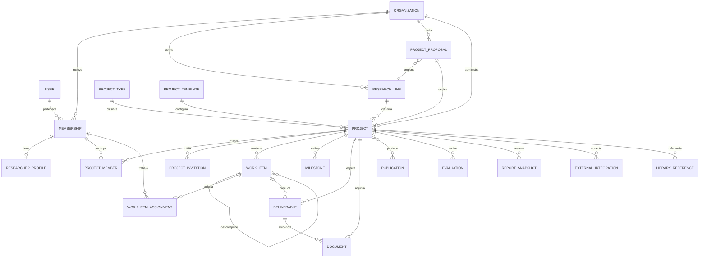

# SIGAP: arquitectura y dominio iniciales

**Estado:** propuesta inicial para revisión  
**Fecha:** 18 de noviembre de 2026

## Propósito

SIGAP será una plataforma para dar seguimiento a investigaciones y proyectos: desde su propuesta y aprobación hasta la ejecución, entregables, revisiones y resultados publicados. El legado en `MOCKUP/` y `BD/` sirve como referencia histórica; el remake comenzará con una aplicación nueva y migraciones explícitas, sin depender de las tablas ni de las rutas antiguas.

## Decisiones de arquitectura

### Aplicación modular, desplegada como una unidad

Empezar como un **monolito modular**: un backend, una base de datos y un frontend. Separar el código por dominios de negocio y mantener contratos claros entre módulos. Esto permite construir un producto coherente sin cargar desde el inicio con despliegues, redes y transacciones distribuidas de microservicios. Los módulos que en el futuro tengan necesidades operativas distintas podrán separarse con evidencia de uso.

La arquitectura MVC aplica en el borde web: los controladores reciben HTTP y devuelven DTOs; no contienen reglas de negocio ni SQL. Dentro del backend, organizar cada módulo en capas pequeñas:

```text
interfaz HTTP (controllers, DTOs)
        ↓
aplicación (casos de uso, transacciones)
        ↓
dominio (reglas e invariantes)
        ↓
persistencia e integraciones (repositorios, almacenamiento)
```

### Stack

| Capa | Decisión inicial |
|---|---|
| Lenguaje backend | Java 17 |
| Framework backend | Spring Boot 4.1.x, usando el último parche compatible al iniciar |
| API | REST/JSON, versionada bajo `/api/v1` |
| Frontend | Angular 22.x, organizado por funciones de producto |
| Base de datos | MySQL 8.x para desarrollo y primera entrega |
| Migraciones | Flyway; cambios de esquema versionados en Git |
| Archivos | Metadatos en MySQL y contenido en almacenamiento de objetos o disco local detrás de una interfaz de almacenamiento |
| Construcción | Maven en backend; npm con lockfile en frontend |

“Java 17” es la versión del lenguaje/runtime; Spring Boot tiene su propio número de versión. Spring Boot 4.1.2 admite Java 17 como mínimo. Angular 17 ya no recibe soporte; Angular 22 está en la tabla de versiones con soporte activo. Por eso conviene conservar Java 17, pero iniciar el remake con Angular 22 y una versión soportada de Spring Boot. Spring anunció que 3.5.16 fue el último lanzamiento OSS de la línea 3.5.x. [Requisitos de Spring Boot 4.1](https://docs.spring.io/spring-boot/system-requirements.html), [soporte de versiones Angular](https://angular.dev/reference/releases), [fin de soporte OSS de Spring Boot 3.5](https://spring.io/blog/2026/06/25/spring-boot-3-5-16-available-now/).

### Organización del repositorio nuevo

```text
backend/
  src/main/java/.../sigap/
    identity/
    organization/
    researchline/
    proposal/
    project/
    task/
    deliverable/
    document/
    publication/
    audit/
  src/main/resources/db/migration/
frontend/
  src/app/core/
  src/app/shared/
  src/app/features/
docs/
infra/
```

Cada módulo backend puede tener `api`, `application`, `domain` e `infrastructure` si la complejidad lo justifica; evitar crear clases vacías o capas ceremoniales. La API no expondrá directamente entidades JPA. Los módulos se comunican mediante casos de uso/servicios internos; no se introducirán eventos distribuidos hasta que exista una necesidad concreta.

## Dominios y modelo lógico inicial

### Actores y límites de responsabilidad

Los tres actores están bien planteados. Conviene modelarlos como **roles con alcance**, no como tipos incompatibles de cuenta: una persona puede ser investigadora en un proyecto y líder en otro. El rol de administrador global se asigna en el nivel de SIGAP; liderazgo e investigación se asignan en una organización o proyecto.

| Actor | Alcance | Responsabilidades principales |
|---|---|---|
| **Administrador SIGAP** | Plataforma u organización | Gestiona usuarios, organizaciones, catálogos, roles y configuración. No necesita acceso rutinario al contenido académico de todos los proyectos; cualquier acceso excepcional debe quedar auditado. |
| **Docente / líder** | Proyectos que dirige | Crea proyectos o propuestas, invita miembros, define el tipo y las reglas del proyecto, organiza el trabajo, revisa avances y entregables, comenta, califica, genera reportes y métricas, y lleva el seguimiento de publicaciones u obras. |
| **Investigador** | Proyectos donde participa | Consulta el proyecto y sus reglas, ve sus asignaciones, actualiza el estado de su trabajo, colabora, sube evidencias y responde a comentarios. Puede consultar los datos del proyecto necesarios para cumplir sus tareas; la aprobación y evaluación final quedan en el líder salvo que se deleguen. |

La autorización debe comprobar tanto el rol como el alcance del recurso. Ser investigador no da acceso a todos los proyectos de la organización; ser líder no da acceso a proyectos que no dirige. El administrador de plataforma gestiona SIGAP, pero no sustituye al líder en decisiones académicas.

### Identidad y organización

- **Organization**: institución, departamento o espacio de trabajo dueño de los datos. Incluir desde el inicio `organization_id` en las entidades de negocio para habilitar más de una organización y aislar datos.
- **User**: identidad global, correo normalizado, nombre y estado. No guardar contraseñas en texto plano; usar el mecanismo de hashing de Spring Security o un proveedor OIDC.
- **Membership**: relación entre usuario y organización, con estado y fechas. Un usuario puede pertenecer a varias organizaciones.
- **Role / Permission**: permisos agrupados en roles de plataforma, organización y proyecto. Asignar el liderazgo mediante membresía al proyecto y conservar la posibilidad de delegar responsabilidades acotadas. Validar permisos también en el backend; ocultar botones en Angular no es autorización.
- **ResearcherProfile**: datos académicos del miembro (identificador institucional, adscripción, perfil profesional), separados de la cuenta de acceso.

### Investigación y proyectos

- **ResearchLine**: línea o área de investigación de una organización.
- **ProjectType / ProjectTemplate**: define el tipo de proyecto (por ejemplo, investigación doctoral o desarrollo de software), campos obligatorios, etapas, entregables y estructura de trabajo permitida. El líder elige una plantilla al iniciar el proyecto; versiones ya usadas por proyectos no deben cambiar retroactivamente.
- **IdentifierPolicy**: regla versionada para generar el código visible del proyecto según organización, tipo y secuencia (por ejemplo, sigla-año-folio). Mantener una clave primaria interna estable por separado y garantizar unicidad en base de datos; el formato no debe codificar datos personales.
- **ProjectProposal**: título, problema, objetivos, metodología, línea propuesta, autores, fechas y estado de revisión. Registra quién revisó y cuándo, junto con observaciones y decisión.
- **Project**: proyecto aprobado/ejecutable, código único dentro de su organización, tipo y versiones de plantilla/políticas, título, objetivos, fechas planificadas/reales, estado, línea y autoría.
- **ProjectInvitation**: invitación de un líder a una persona para participar en un proyecto, con estado pendiente/aceptada/rechazada/revocada, vencimiento y quién la emitió.
- **ProjectMember**: relación muchos-a-muchos entre proyecto y miembros; rol en el proyecto y fechas de participación. No asumir que el dueño del proyecto es su único investigador.
- **WorkItem**: unidad jerárquica de trabajo con tipo, descripción, estado, prioridad, fechas, padre opcional y posición. La plantilla puede habilitar épicas, tareas, subtareas o fases de investigación según el tipo de proyecto; no forzar épicas en proyectos donde no tengan sentido.
- **WorkItemAssignment**: relación entre unidad de trabajo y miembro responsable/colaborador. Permite asignar varias personas sin perder quién es responsable principal.
- **WorkflowTemplate / WorkflowStage**: etapas y transiciones permitidas para cada tipo de proyecto. Define quién puede mover el trabajo de etapa y qué evidencia se requiere.
- **Milestone**: hito del proyecto con fecha objetivo, estado y criterio de aceptación.
- **Deliverable**: producto esperado/revisable asociado al proyecto o a una tarea, con fecha límite, tipo y estado de aprobación.
- **Document**: metadatos de archivo (nombre original, clave de almacenamiento, MIME, tamaño, checksum, quien lo subió, fecha). Asociarlo explícitamente a proyecto, tarea o entregable. No guardar rutas físicas del servidor como contenido del archivo.
- **Publication** y **ProjectPublication**: publicación académica y vínculo con uno o varios proyectos; incluir DOI/URL, revista/congreso, fecha, autores, responsables y etapa editorial (planificada, en preparación, enviada, en revisión, aceptada, publicada o descartada).
- **Review / Comment**: observaciones y decisión asociadas a una propuesta o entregable, con autor y marcas de tiempo.
- **Evaluation / Rubric**: criterios y calificaciones de seguimiento o evaluación, asociados a proyecto, entregable o periodo. Guardar evaluador, fecha, criterio, puntuación y comentario; las reglas de cálculo deben ser explícitas y auditables.
- **ProjectMetric / ReportSnapshot**: métricas con definición y periodo, y una instantánea de reportes generados. Diferenciar valores calculados al momento de consulta de reportes históricos cerrados.
- **ExternalIntegration / ExternalReference**: conexión opcional por organización/proyecto a GitHub, GitLab, Azure DevOps u otros proveedores; guardar proveedor, repositorio remoto y credenciales mediante un gestor de secretos. Sincronizar solo referencias necesarias (commit, merge request/pull request, pipeline) y no replicar el repositorio dentro de SIGAP.
- **LibraryReference**: referencia externa a catálogo, biblioteca o registro académico; guardar identificadores, URL y fuente. La integración con portales bibliográficos queda para una etapa posterior.
- **AuditEvent**: actor, organización, acción, entidad afectada, fecha y referencia de cambios; no almacenar secretos ni contraseñas en la bitácora.

### Relaciones principales



La tabla es conceptual, no DDL final. Antes de implementarla hay que acordar los estados y transiciones, qué campos son obligatorios, si una propuesta aprobada se convierte en proyecto y qué datos académicos exige la institución.

Cada proyecto debe conservar la versión de su plantilla y de sus políticas de identificador. Así, cambiar las reglas para proyectos futuros no altera los identificadores, etapas ni entregables de proyectos activos.

## Reglas de datos y portabilidad

- Usar claves primarias internas estables y restricciones FK/UNIQUE/CHECK; usar UUID o un identificador público separado para URLs y API cuando sea útil.
- Toda entidad de negocio pertenece a una organización y sus consultas deben filtrar por esa organización.
- Definir unicidad contextual: por ejemplo, `organization_id + project_code`, no necesariamente código global.
- Usar `DECIMAL` para datos exactos, `DATE` para fechas sin hora y UTC para marcas de tiempo.
- Modelar estados como catálogos o valores controlados por la aplicación; evitar depender de `ENUM` propietario de MySQL.
- Usar SQL portable para el CRUD común y migraciones Flyway revisables. No basar el dominio en funciones exclusivas de MySQL. Migrar a PostgreSQL en el futuro requerirá validar tipos, índices, búsquedas, transacciones y migraciones; JPA no hace automática esa migración.
- Soft delete solo donde exista una necesidad de recuperación/auditoría. Para datos sensibles, definir retención y eliminación explícitas.

## Prioridades del remake

### MVP funcional

1. Organización, cuentas, membresías, autenticación y autorización.
2. Propuestas con revisión y decisión auditada.
3. Proyectos con tipo/plantilla, identificador y miembros; invitaciones con aceptación o rechazo.
4. Épicas (cuando la plantilla las habilite), tareas, asignaciones, fechas e hitos.
5. Entregables, revisión, comentarios y documentos con metadatos seguros.
6. Tablero de seguimiento, métricas básicas e historial de actividad.

El seguimiento básico de publicaciones y evaluaciones forma parte del dominio, pero integraciones con bibliotecas digitales, conectores DevOps, reportes institucionales avanzados, notificaciones complejas y analítica quedan para fases posteriores. Diseñar adaptadores para esas conexiones, sin acoplar el núcleo a un proveedor.

## Oportunidades observadas en el legado

1. **Autenticación:** la contraseña se guarda y compara en texto plano; el nuevo sistema necesita hash seguro, recuperación de cuenta y control de sesiones.
2. **Autorización:** varias acciones de lectura/escritura no verifican de forma consistente el rol o la propiedad de los datos; autorizar cada operación y organización en el servidor.
3. **Integridad de datos:** el volcado actualizado omite la definición de `investigador`, hay relaciones duplicadas en `proyecto`, y algunos campos/consultas no coinciden entre PHP y SQL.
4. **Archivos:** mezcla rutas locales y columnas `LONGBLOB`; no valida adecuadamente tipo/tamaño y utiliza nombres originales en rutas. Separar metadatos y contenido, validar, limitar y servir descargas con autorización.
5. **Flujo académico:** hay propuestas, proyectos y tareas, pero los estados, aprobaciones, asignaciones, hitos y entregables no forman un ciclo uniforme.
6. **Seguimiento:** porcentaje de avance en proyecto y tarea puede divergir; definir métricas calculables y conservar historial de cambios.
7. **Mantenimiento:** conexión y rutas dependen de XAMPP local, abundan consultas dentro de páginas y existen varias copias de SQL. Introducir configuración por entorno, API, migraciones y documentación de ejecución.
8. **Evolución:** no hay una frontera clara para una organización/tenant ni para roles dentro de un proyecto. Modelar esas relaciones ahora reduce reescrituras, sin desplegar microservicios prematuramente.

## Ruta de trabajo sugerida

1. Acordar permisos de los tres actores, proceso de propuesta y ciclo de vida de cada tipo de proyecto.
2. Convertir las decisiones aceptadas en ADRs breves (arquitectura, autenticación, tenant, archivos).
3. Crear esqueletos `backend/` y `frontend/` independientes del legado.
4. Definir el modelo relacional v1 y la primera migración Flyway; probarla en una BD nueva, no en el dump histórico.
5. Implementar primero identidad/organización y el flujo propuesta → proyecto → tarea → entregable.
6. Añadir pruebas de reglas de dominio, API y aislamiento entre organizaciones desde el primer módulo.
7. Migrar solo los datos históricos que tengan significado y calidad verificable; mantener el dump como referencia, no importarlo a ciegas al nuevo esquema.
